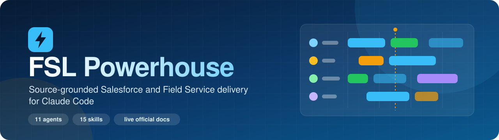
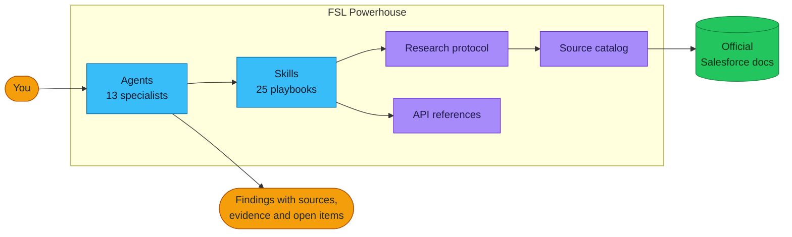

<div align="center">



<br>

[](https://github.com/Hcision/fsl-powerhouse/actions/workflows/validate.yml)
[](.claude-plugin/plugin.json)
[](LICENSE)
[](https://github.com/Hcision/fsl-powerhouse/commits/main)
[](https://github.com/Hcision/fsl-powerhouse/stargazers)


**[Quick start](#-quick-start)** · **[How it works](#-how-it-works)** · **[Agents](#-agents)** · **[Skills](#-skills)** · **[Live docs](#-live-documentation)** · **[Topic map](knowledge/fsl-topic-map.md)** · **[Contribute](CONTRIBUTING.md)**

</div>

---

A Claude Code plugin for Salesforce delivery that checks official documentation before it answers. Field Service is the main focus: architecture, scheduling and optimization, preventive maintenance, mobile and offline, and service operations. Platform skills cover Apex, LWC, Flow, security, testing, packaging, releases and Jira-to-code delivery.

<table>
<tr>
<td width="33%" valign="top">

### 📖 Source-grounded

Every answer separates official guidance, what your repository shows, and assumptions. Sources are cited with the date they were checked.

</td>
<td width="33%" valign="top">

### 🛠️ Field Service first

Dedicated playbooks for scheduling, maintenance plans, mobile and operations, with API anchors read from the official guides.

</td>
<td width="33%" valign="top">

### 🔒 Safe by default

Reviewers are read-only. Deployment, activation, org writes and ticket updates need your explicit go-ahead.

</td>
</tr>
</table>

## 🚀 Quick start

Install from GitHub in an active Claude Code session:

```text
/plugin marketplace add Hcision/fsl-powerhouse
/plugin install fsl-powerhouse@fsl-powerhouse
```

Then try one of these:

> 💬 *"Use the FSL Powerhouse to review the scheduling flow in this repo. Determine which engine and policy it uses, verify the applicable Salesforce docs, and give me a test matrix."*

> 💬 *"Use live Salesforce documentation to explain how to test an Agentforce agent. Cite the current Testing Center guidance and check whether it applies to Agentforce for Field Service."*

For ticket work, any tracker works. If Jira, Azure DevOps, GitHub Issues or another tool is connected to Claude Code, give the ticket ID. If not, paste the ticket text or point to a file. No connection is required.

## 🧭 How it works



An agent preloads its playbooks, follows the research protocol to find the right official page, and reports what it verified and what it could not.

## 🤖 Agents

Thirteen specialists (13 agents). Claude delegates to them automatically, or you can name one.

| Agent | What it does | Mode |
| --- | --- | --- |
| `field-service-architect` | End-to-end Field Service design across data model, scheduling, maintenance, mobile and operations | ✏️ Can edit |
| `field-service-scheduling-reviewer` | Scheduling, appointment booking, policies, Gantt and optimization | 🔍 Read-only |
| `field-service-maintenance-reviewer` | Maintenance plans, recurrence, work order generation and volume | 🔍 Read-only |
| `field-service-mobile-reviewer` | Mobile app, offline sync and technician workflows | 🔍 Read-only |
| `field-service-operations-reviewer` | Service execution, inventory, asset coverage and customer engagement | 🔍 Read-only |
| `field-service-troubleshooter` | Diagnoses Field Service failures from symptoms | 🔍 Read-only |
| `salesforce-architect` | Architecture, integrations and standard-versus-custom fit | ✏️ Can edit |
| `apex-engineer` | Apex triggers, transactions, async jobs, integrations and tests | ✏️ Can edit |
| `lwc-engineer` | Lightning Web Components and Jest tests | ✏️ Can edit |
| `flow-specialist` | Flows and declarative configuration | ✏️ Can edit |
| `salesforce-security-reviewer` | Access, data visibility and defensive controls | 🔍 Read-only |
| `salesforce-qa-reviewer` | Acceptance criteria, regressions, tests and packaging readiness | 🔍 Read-only |
| `salesforce-release-analyst` | Seasonal releases, monthly updates and Field Service patches | 🔍 Read-only |

Read-only agents report findings, and the main session applies any change.

## 📚 Skills

25 skills: task-specific playbooks with evidence and validation requirements. Field Service is covered area by area, and the [topic map](knowledge/fsl-topic-map.md) shows which skill handles what.

<table>
<tr>
<th width="50%">🛠️ Field Service</th>
<th width="50%">⚡ Platform</th>
</tr>
<tr>
<td valign="top">

- `fsl-architecture`: product layers, lifecycle, limits 📎
- `fsl-workforce-territories`: resources, territories, shifts, capacity 📎
- `fsl-scheduling`: policies, booking, optimization 📎
- `fsl-dispatch-console`: Gantt, lists, custom actions 📎
- `fsl-preventive-maintenance`: plans, recurrence, generation 📎
- `fsl-mobile-offline`: mobile app, LWC offline, deep links 📎
- `fsl-operations`: work plans, service reports, closure 📎
- `fsl-inventory`: stock, requests, transfers, returns 📎
- `fsl-assets-entitlements`: assets, warranties, SLAs, contracts
- `fsl-customer-engagement`: live tracking, self-service booking 📎
- `fsl-security-licensing`: licenses, permission sets, sharing 📎
- `fsl-integration-data`: REST, actions, data loads, deployment 📎
- `fsl-analytics`: reports, dashboards, KPIs 📎
- `fsl-agentforce-ai`: agents and AI in Field Service 📎
- `fsl-troubleshooting`: symptom to documented cause 📎

</td>
<td valign="top">

- `apex-engineering`: triggers, limits, async, tests
- `lwc-engineering`: components, data, accessibility, Jest
- `flow-configuration`: flows and declarative automation
- `salesforce-architecture`: design decisions and integrations
- `salesforce-security`: sharing, CRUD/FLS, guest exposure

</td>
</tr>
<tr>
<th>🚢 Delivery</th>
<th>🌐 Knowledge</th>
</tr>
<tr>
<td valign="top">

- `salesforce-quality`: audit, Code Analyzer, regression, 2GP
- `salesforce-ticket-delivery`: any ticket or pasted story to tested change
- `salesforce-release-watch`: release impact assessment

</td>
<td valign="top">

- `salesforce-live-docs`: answers from current official docs
- `salesforce-knowledge-grounding`: Lightning Knowledge and Agentforce Data Library

</td>
</tr>
</table>

📎 Ships a `reference.md` of facts read from official Salesforce pages, with the date and the links.

## 🌐 Live documentation

The plugin searches Salesforce's official websites when you ask about Field Service, Service Cloud, Agentforce or the platform. It needs web search and fetch access in your Claude Code session. It starts with one precise search and up to two official pages per question, and reads more only when evidence is missing. No local import, index or refresh schedule is needed.

<details>
<summary><b>Salesforce Help articles</b></summary>

<br>

Articles on help.salesforce.com render in the browser only, so a plain web fetch often returns an empty page. The optional third-party [`sf-docs` skill](https://github.com/Jaganpro/sf-skills/tree/main/skills/sf-docs) (MIT) reads them through a headless browser.

```sh
npx skills add Jaganpro/sf-skills --skill sf-docs --agent claude-code -g
```

Its scripts need Playwright and a Chromium download. When it is installed, the research protocol uses it for pages that come back empty. Without it, the agents report the page as unverified.

</details>

<details>
<summary><b>Lightning Knowledge and Agentforce</b></summary>

<br>

Use the `salesforce-knowledge-grounding` skill to plan Lightning Knowledge article publishing, Agentforce Data Library setup and persona-based retrieval tests. For example, ask it to design a missing-part procedure for technicians and validate when the agent should answer or escalate.

Public Salesforce documentation is fetched live. Consulting your org's private Knowledge articles requires an authorized org connection.

</details>

## 🧱 What's inside

```text
fsl-powerhouse/
├── .claude-plugin/     plugin and marketplace manifests
├── agents/             13 specialists
├── skills/             25 playbooks, 14 with a verified reference.md
├── knowledge/
│   ├── sources.json            curated official reference catalog
│   ├── fsl-topic-map.md        every Field Service area and its skill
│   ├── research-protocol.md    documentation workflow and research map
│   └── release-baseline.md     release baseline and verified Field Service changes
└── tests/              catalog, manifest and agent-reference checks
```

## 🔧 Develop

Clone the repository and load the plugin in place from the directory containing it:

```sh
claude --plugin-dir ./fsl-powerhouse
```

See [CONTRIBUTING.md](CONTRIBUTING.md) for how to add a topic or a verified fact. Validate before opening a pull request:

```sh
python3 -m unittest discover -s tests -v
claude plugin validate . --strict
```

## 🙏 Design references

[Craft Anything](https://github.com/storytold/craft-anything) informs the research-first workflow. [ECC](https://github.com/affaan-m/ECC) informs the modular agents and skills structure and the practice of writing a handoff before context compaction. The plugin uses original Salesforce playbooks.

Claude Code format references: [plugins](https://code.claude.com/docs/en/plugins-reference) and [plugin marketplaces](https://code.claude.com/docs/en/plugin-marketplaces).

## 📄 License

[MIT](LICENSE) © Hcision

<div align="center">
<sub>Not affiliated with or endorsed by Salesforce. Salesforce and Field Service are trademarks of Salesforce, Inc.</sub>
</div>
